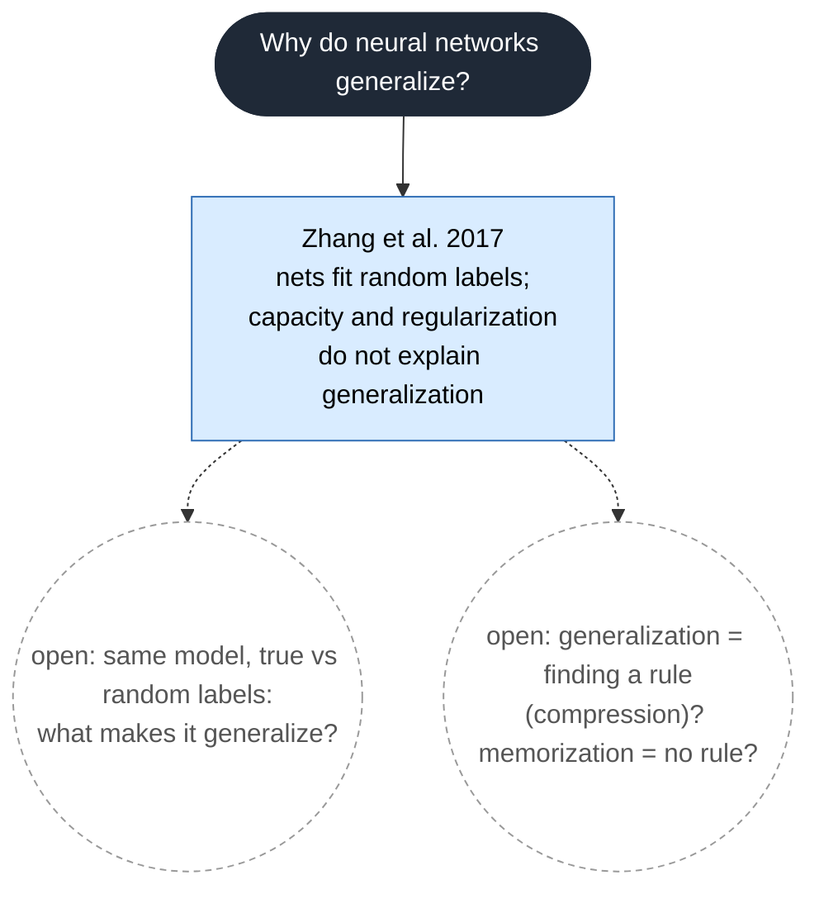

# Knowledge tree

This diagram shows how each paper connects to our question. After each session, the session leads add a node for their paper.

## How to add your paper

1. Open this file on github.com. Click the pencil icon.
2. Copy the code between ```` ```mermaid ```` and ```` ``` ````.
3. Paste the code into https://mermaid.live. You can see the diagram there while you edit.
4. Add one node for the paper. Add one or more arrows to show where it connects.
5. Copy the code back into this file. Click **Preview** to make sure that the diagram shows correctly.
6. Add one row to the table below the diagram.
7. Make a pull request.

## Symbols

| Item | Code |
|---|---|
| Paper (use the session number) | `P01["Author Year<br/>main claim in a few words"]` |
| Sub-question | `Q1["sub-question"]` |
| Open question | `O1(("open: ..."))` |
| Builds on | `A --> B` |
| Challenges | `A ==>|challenges| B` |
| Leaves open | `A -.-> O1` |

Do not delete a node that another person added. If you disagree with it, add a "challenges" arrow.

## Diagram



## Papers in the tree

| Node | Paper (link) | Session | What it adds | What it leaves open |
|---|---|---|---|---|
| P01 | [Zhang et al. 2017, Understanding deep learning requires rethinking generalization](https://arxiv.org/abs/1611.03530) | [1](sessions/Session_1/) | Shows that model capacity and regularization do not explain why deep networks generalize: the same model fits true and random labels. | What does explain generalization? Is it about finding a rule (compression)? |
