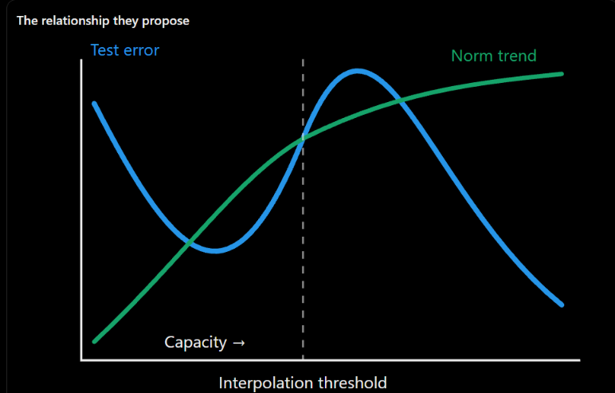

# SAMI: SESSION 02 NOTES
### Terms to know:
__Overfitting__ : Model memorizes the training data and fails to generalize. High variance implies overfitting.  
__Underfitting__ : Model is too simple to fit the training data. High bias implies underfitting.  
__Interpolation__ : When the training error of the model becomes 0.  

### General Belief:
Generally in machine learning it was believed that if the model is made too complex (complexity is directly proportional to the number of parameters) then it would overfit on the training data. Otherwise if its too simple then it woul underfit. So we had to find that sweet spot between overfitting and underfitting such that the model could perform well on test data.    
### Problem
Modern models like neural networks are trained to exactly fit the training data. Classically it would be considered as overfitting. But when tested they obtain high accuracy on the test data.  
### Findings:
Researchers started to train the models starting from lesser complexity to more complexity. First they observed that the testing error gradually decreased but after a certain point it started increasing again. But they did not stop there and kept increasing the complexity. To their surprise after a certain complexity the test error started decreasing again.  
This was really surprising as traditional as it went against they classical belief. They called this phenomenon the __DOUBLE DESCENT__ as there existed a second descent later on when complexity was increased further.
They didnt only try on neural networks but they also tried on machine learning ensemble algorithms like Adaboost and Random Forest and got the same results (double descent).  
  
To solidify their claim they took image,sound and text datasets and trained neural networks on them and for each kind of data double descent was observed. They also changed the features to Random fourier features and Random ReLU features in order to make sure that their hypothesis works on all kinds of data

### Reason for Double Descent:
Although the authors observed double descent but they did not find out why it happened. All they give in the paper is that it might be because of l2 Norm. The trend they observed was as follows:
  

As observed in previous paper there are multiple solutions and we dont know which one will generalize better so the authors say that the one with a specific L2 norm (that spreads over more data will generalize better)

